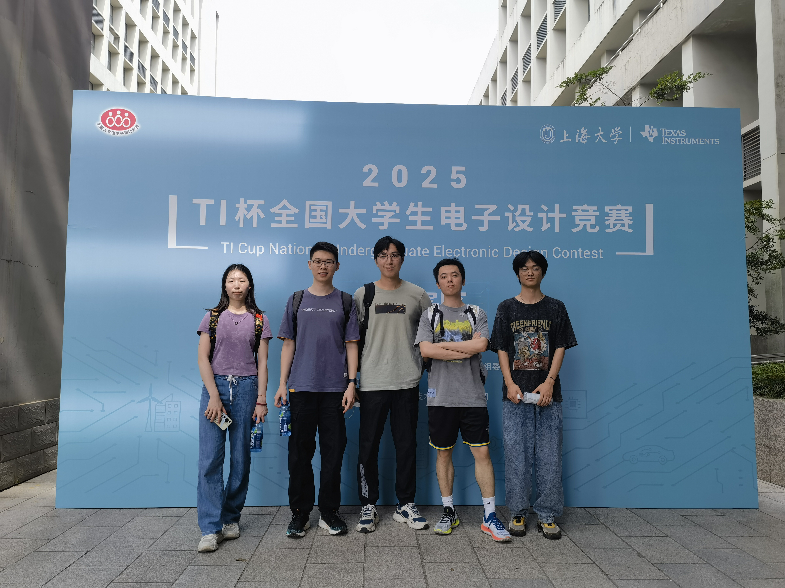
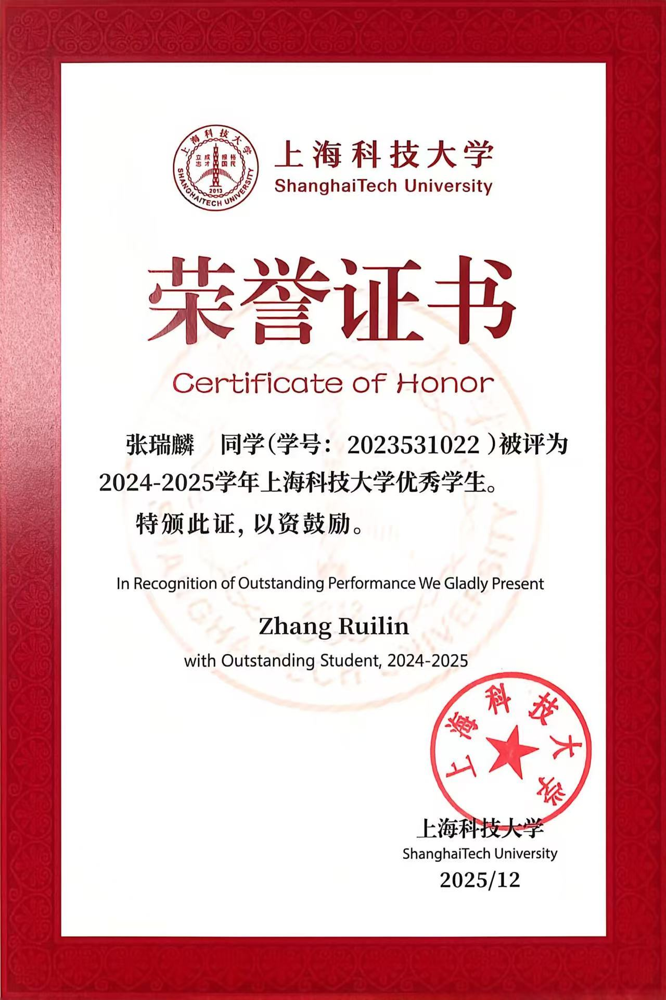

## About Me

I am an undergraduate student researcher at Robotics Interface and Manipulation Lab, School of Information and Science Technology (SIST), ShanghaiTech University, supervised by Prof. [Chenxi Xiao](https://scholar.google.com/citations?user=Qhiy3doAAAAJ&hl=zh-CN&oi=ao). My research mainly focuses on edge computing for visuotactile sensors and multimodal tactile sensing in improving dexterous manipulation. I will join SIST at ShanghaiTech University as an M.S. student in 2027, and expect to graduate in 2030.

## Research Interests

- **Tactile sensing hardware:** on-sensor computing, near-sensor architectures for visuotactile perception
- **Multimodal perception:** proximity–tactile fusion, wearable sensing for cross-embodiment hand data collection
- **Dexterous manipulation:** learning-based grasping, robot hardware co-design

## News

- **[Aug. 2025]** Joined Robotics Interface and Manipulation Lab ([RIMLAB](https://rim-laboratory.github.io/)), SIST, advised by Prof. [Chenxi Xiao](https://scholar.google.com/citations?user=Qhiy3doAAAAJ&hl=zh-CN&oi=ao).
- **[Feb. 2025]** Joined Motor and Motion-control Lab ([m&m Lab](https://faculty.sist.shanghaitech.edu.cn/chenjh/)), SIST, advised by Prof. [Jiahao Chen](https://scholar.google.com/citations?user=Qhiy3doAAAAJ&hl=zh-CN&oi=ao).
- **[Sep. 2023]** Joined ShanghaiTech University as a B.S. student.



## Projects

- **[Image Signal Processing](https://github.com/bey0ndt1me/ISP)**: Reconstructed RGB image from RAW camera data, and adjusted image parameters to adapt human-eye vision.
- **[LCR meter](https://github.com/bey0ndt1me/LCR-meter)**: Measured resistance, capacitance, and inductance by analyzing the impedance response of components under an AC excitation signal.

## Awards

- **Second Place**, 2025 TI Cup National Undergraduate Electrical Design Contest
- **Outstanding Student of SIST**, 2024–2025 Academic Year

  
  


